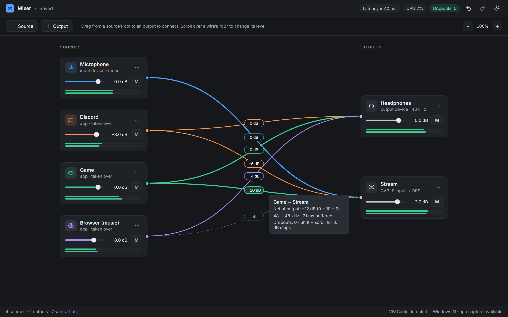
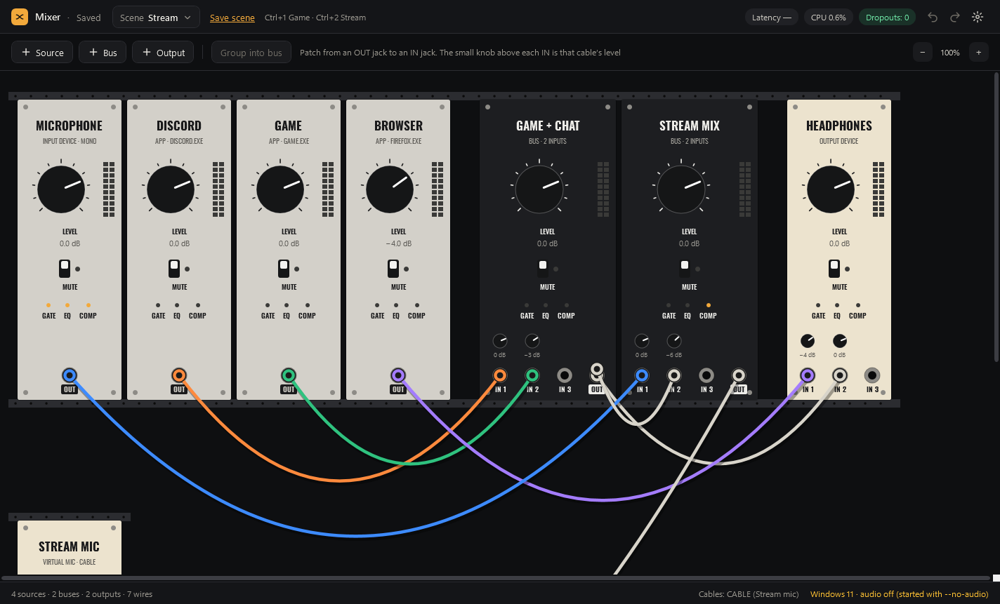
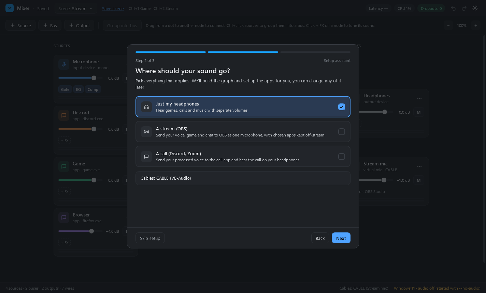
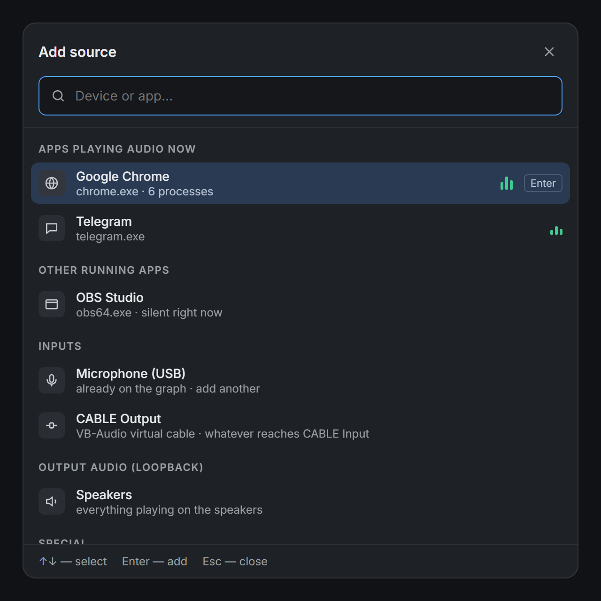
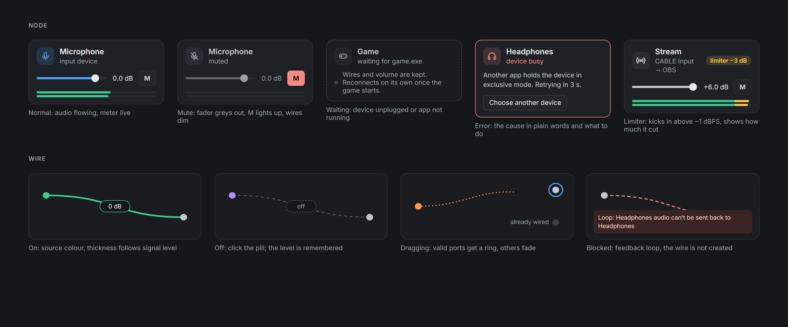

# Mixer for Windows

Mixer collects audio from different places and routes it where you need it. Your microphone, a game, Discord and music go in on one side; headphones and your stream come out on the other. Every connection is a wire, and every wire has its own volume. You can see at a glance what goes where, with no need to keep buses A1–B3 in your head as in Voicemeeter.




What it does:

- takes audio from microphones and other inputs, from any output (whatever is playing in your headphones or speakers) and **from a single application**: Discord, a browser, a game, a music player;
- plays to any playback device, including the VB-Cable virtual cable, so you can hand the mix to OBS or Discord;
- sets the volume of every source, every output and every wire separately, with a level meter on each;
- groups sources into **buses**: one fader for "game + chat", fewer wires;
- cleans up your voice with a **gate, equalizer and compressor** on any node, with ready-made presets;
- runs **VST3 effects** on any node: noise removal, a de-esser or a voice changer on the microphone, reverb on the stream, a limiter on a bus. Each plug-in runs in its own process, so a crashing plug-in doesn't take your stream down;
- sends an application straight to its output when it needs nothing from the mixer (**direct route**: no added latency or CPU);
- opens devices with **low latency** where the sound card driver allows it;
- saves your layout automatically and restores it on start, picks up unplugged and reconnected devices, and survives sleep.

## What's new in 2.1

- **Setup assistant**: three questions (your devices, where your sound goes, which apps to keep separate) and Mixer builds a ready layout, virtual cables and all. It opens on first start and from Settings.
- **Virtual cables** are one thing with a role, not two devices with cryptic names: a *virtual mic* (Mixer plays into the cable, OBS or Discord records from it) or a *virtual input*. **Use as microphone in…** makes the cable the microphone of OBS or Discord for you.
- **Scenes**: named sets of levels ("Game", "Stream", "Call"), switched smoothly in 150 ms from the header, the tray or a hotkey.
- **Global hotkeys**, including in a full-screen game: mute, volume ±1 dB, scenes, **push-to-talk** and push-to-mute.
- **Tray icon** with your microphone's state, **start with Windows** minimized to the tray, notifications when a device disconnects.
- **Themes**: Graphite (the dark one), **Daylight** for bright rooms and **Modular**, a Eurorack case with knobs and patch cables.



## What's new in 2.0

- **Buses**: a middle column between sources and outputs. Select sources and group them in one click; levels stay the same.
- **Processing**: gate, EQ and compressor on every source, bus and output, with an EQ curve you drag with the mouse.
- **All system audio** can leave out chosen programs (say, a messenger), and shows which processes it skipped and why.
- New applications are picked up within tens of milliseconds, so the first notification sound isn't lost.
- **Direct routes**: an application that goes to exactly one output, unprocessed, plays there directly.
- **Low latency** on outputs (and, experimentally, on inputs) where the driver supports small buffers.
- Your 1.0 layout is moved over automatically (see "Upgrading from 1.0").

## Requirements

- **Windows 11**, 64-bit. On Windows 10 (version 1809 or later) Mixer starts, but capturing individual applications may be unavailable; applications are then greyed out in the list with an explanation.
- **VB-Cable**, if you want to hand the mix to another program (OBS, Discord, Zoom). It is a free download from [vb-audio.com/Cable](https://vb-audio.com/Cable/). You don't need it to mix into your headphones.
- No .NET installation: everything is inside `Mixer.exe`.

## Getting started

1. Download `Mixer.exe` and put it in any folder.
2. Run it. There is nothing to install.
3. If Windows shows "Windows protected your PC", click **More info → Run anyway**. Windows does this for any program without a digital signature, and asks only once.

On first start the **setup assistant** opens (see below); you can skip it and build the layout by hand.

Mixer keeps working when you close its window: it hides in the tray, by the clock. Click the icon to open it again; **Exit** is in the icon's menu. When Mixer exits, audio through it stops and applications play as usual again. Only one copy runs at a time: starting it again shows the open window.

To start Mixer with Windows, tick **Start with Windows, minimized to the tray** in the assistant or in Settings (⚙). Mixer then starts in the tray, and your layout plays without opening the window.

## Setup assistant

Three steps, then Mixer builds the layout:

1. **Your headphones and microphone.** The Windows defaults are preselected.
2. **Where should your sound go?** *Just my headphones* (separate volumes for apps), *a stream (OBS)* (your voice and the game go to OBS as one microphone) and/or *a call (Discord, Zoom)* (your processed voice goes to the call). A stream and a call each need a virtual cable; the assistant counts the cables it found, links to [vb-audio.com/Cable](https://vb-audio.com/Cable/) and notices a new one as soon as it is installed.
3. **Which apps should stay separate?** Each gets its own volume in your headphones and stays off the stream.



The result is an ordinary layout you can change by hand. The microphone gets the "Voice — clean" processing; OBS (and Discord for a call) get the cable as their microphone. In OBS and Discord, set the microphone to **Default**: a device chosen inside the app overrides what Windows says. Running the assistant again from Settings replaces the layout; Ctrl+Z brings the old one back.

## Your first layout

The window is a canvas: **sources on the left, outputs on the right**, wires in between. Audio always flows left to right.

Example for streaming: you hear the game and Discord in your headphones, while your microphone, the game (a bit quieter) and Discord go to the stream.

1. Click **+ Source** (`+ Источник`) and pick your microphone. Add the game and Discord the same way: they are under "Applications playing audio" (`Приложения со звуком`), or under "Other running applications" (`Другие запущенные приложения`) if they are silent right now. The list has a search box.

   

2. Click **+ Output** (`+ Выход`) and add your headphones and **CABLE Input**, the input of the virtual cable; you will pick it in OBS later.
3. Drag wires from the dot on the right of a source to an output:
   - game → headphones, game → CABLE Input;
   - Discord → headphones, Discord → CABLE Input;
   - microphone → CABLE Input.
4. Hover over the "0 dB" label in the middle of the game → CABLE Input wire and scroll down to −10 dB. Now the game doesn't drown out your voice on stream, and still sounds the same in your headphones.
5. In OBS, add an "Audio Input Capture" source and select **CABLE Output** in it.

Discord takes your microphone directly, as usual: there is no need to route it through Mixer.

The layout saves itself a second after every change. Undo is Ctrl+Z.

Four sources going to two outputs make eight wires. To tidy that up, Ctrl+click the game and Discord, then click **Group into bus** (`Сгруппировать в шину`): Mixer adds a bus "Bus 1" in the middle column, wires both sources into it and the bus into both outputs. Every level stays exactly as it was, and now one fader turns the whole group up or down.

## Sources and outputs

| Source | What it is |
| --- | --- |
| **Input** (`Входы`) | a microphone, line input, CABLE Output |
| **Output audio** (`Звук выходов (loopback)`) | everything currently playing on the chosen device (headphones, speakers) |
| **Application** | the audio of one program, matched by its exe name. If the program isn't running, the node waits and connects by itself when it starts |
| **All system audio** (`Весь звук системы`, under `Особые`) | all programs except Mixer itself. Only one per layout |
| **Default device** (`по умолчанию`) | the microphone or output selected as default in Windows. Change the device in Windows and the node follows. The "communications" variant (`для связи`) follows the default communications device, the one Discord and calls use |

An output is any playback device: headphones, speakers, CABLE Input.

## Virtual cables

A virtual cable (VB-Cable, Cable A–D, Hi-Fi Cable, Virtual Audio Cable) has two ends: an input that programs play into and an output that programs record from. Mixer pairs the ends by itself and shows a cable as one node with a role, under **Virtual cables** in the + Output and + Source lists:

- **virtual mic** (+ Output): Mixer plays into the cable, and OBS or Discord records from it as a microphone;
- **virtual input** (+ Source): a program plays into the cable, and Mixer records from it.

The card shows the role and the cable name; the bottom bar lists your cables and who uses them ("Cables: CABLE-A (Stream mic) · CABLE-B free").

**Use as microphone in…** (in the virtual mic's menu) makes the cable's output the recording device of OBS, Discord or any program you name, the same as picking it for that app in the Windows sound settings. The app keeps it after Mixer exits; untick the app or delete the node to undo it. The app must have its microphone set to **Default** inside it. The card warns you when the app still records from another device, when some other program also plays into your virtual mic, and when the two ends of a cable run at different sample rates (a common cause of crackling).

A cable Mixer doesn't know can be linked by hand: node menu → **Link as virtual cable**, and pick the device at its other end.

A **bus** (**+ Bus**, `+ Шина`) sits in the middle column. Several sources (or another bus) go in, and the sum goes on to outputs. It has its own fader, mute, meter and processing. A bus can feed another bus, but no more than two in a row. A bus with no inputs or no outputs is drawn faded: nothing is heard through it. "Ungroup" (`Разгруппировать`) in the bus menu turns it back into direct wires at the same levels.

Every node has a volume from −60 to +12 dB, an **M** button (mute) and a level meter. A source's menu also has **mono** (sum the left and right channels, handy for a microphone that records into one channel) and balance. If an output gets too loud, a limiter gently holds it back, and a badge lights up on the card.

## Controls

| To do this | Do this |
| --- | --- |
| Add a node | **+ Source** / **+ Output**, or right-click an empty spot in a column |
| Connect | drag from the dot on a node to a node in the other column; or node menu → "Send to…" (`Вывести в…`) / "Receive from…" (`Принимать из…`) |
| Wire volume | scroll over the "dB" label on the wire (with Shift, in 0.1 dB steps), or drag the label up and down |
| Turn a wire off | click the "dB" label; double-click to reset to 0 dB |
| Node volume | the fader, or scroll over it; double-click for 0 dB |
| Move or delete a wire | drag the wire by its end (near the node) to another node or into empty space; or select it and press Delete; or right-click → "Delete" (`Удалить провод`) |
| Rename | double-click the name, or F2 |
| Mono, balance, colour, another device | node menu: "⋯" or right-click |
| Group sources into a bus | Ctrl+click two or more sources, then **Group into bus**; or right-click one of them |
| Processing | click **+ FX** or a Gate · EQ · Comp chip on the card |
| Scene | the **Scene** button in the header; **Save scene** stores the current levels |
| Hotkeys | node menu → **Hotkeys**; scene hotkey in the Scene menu |
| See routes | hover over a node: its wires light up |
| Undo / redo | Ctrl+Z / Ctrl+Y |
| Zoom | Ctrl + mouse wheel, Ctrl +/−/0 |
| Scroll | drag with the middle mouse button, or with Space held down |

Hover over a wire to see its total gain, sample rate conversion and latency.

## "Take over": so an application doesn't play twice

When you add an application to Mixer, it keeps playing to its own speakers too. Without extra setup you would hear it twice: directly and through Mixer.

That is why an Application node has a **Take over** switch (`Забрать себе`, in the node menu, on by default). Mixer asks Windows to move the application to a **sink**: a device nobody listens to. The application plays there, and Mixer still captures its audio and sends it along your wires.

Choose the sink once in Settings (⚙ in the top right corner). Good choices:

- **a separate virtual cable**, the best option. Just not the one that goes to OBS or Discord: free VB-Cable has a single cable, additional ones (A, B) are sold on the same site;
- **an unused output** on your sound card with nothing plugged in, such as a digital output or the HDMI output of a monitor without speakers.

Mixer tests the device with a short probe stream before accepting it. If the device isn't suitable, you can't assign it, and Settings explains why.

Good to know:

- When you close Mixer, running applications return to their devices immediately.
- Windows remembers the sink per program, and a program can only be moved back while it is running. So an application you closed before Mixer (or every application, if Mixer crashed) may be silent the next time you start it. Just start Mixer again: it moves such an application back within a couple of seconds of the application starting.
- To fix it by hand, without Mixer: **Settings → System → Sound → Volume mixer**, pick the application and set its output device to "Default". The "Reset" button there does this for all applications at once.
- Some applications move to the sink only when they start playback again. The card then asks you to "restart playback" (`перезапустите воспроизведение`).
- If the sink has fewer channels than your main device (say, 7.1 headphones and a stereo cable), some applications get quieter. Settings warns you about this. Restarting playback in the application helps, or set the cable to 7.1 in its device properties.
- "All system audio" also hears applications in the sink. If it and such an application go to the same output, that application plays twice; the card warns you.

## Scenes

A scene is a named set of levels: node faders and mutes, wire levels and on/off, and which processing blocks are on. Scenes never add or remove nodes and wires, so switching one can't quietly break your layout; a node or wire that the scene doesn't know is left alone.

- **Scene ▾** in the header: pick a scene to switch to it smoothly, in 150 ms, without clicks. **New scene from current levels** adds one.
- A dot after the scene's name means you changed levels since. **Save scene** stores them into the scene; **Reset** brings the scene's levels back.
- The same menu renames the current scene, deletes it and assigns its hotkey. Scenes are also in the tray menu.

## Hotkeys and push-to-talk

Node menu → **Hotkeys**: click a box and press a combination; Backspace clears it. Actions: **mute / unmute**, **volume ±1 dB**, **push-to-talk** (the node is silent until you hold the key) and **push-to-mute** (silent while you hold it). A scene's hotkey is set in the Scene menu.

- Hotkeys work in any program, including a full-screen game.
- A combination needs Ctrl, Alt, Shift or Win, so it doesn't fire while you type; F1–F24 and the numeric keypad work on their own. Push-to-talk can use any key.
- If another program already holds a combination, Mixer says so right away. Assigning a combination Mixer already uses moves it to the new action.
- A short pop-up by the tray confirms each hotkey; turn it off in Settings.
- Push-to-talk watches the keyboard with a hook. Mixer sets it only while a push-to-talk or push-to-mute key is assigned; some anti-cheat and antivirus programs dislike keyboard hooks.

## Tray and startup

The tray icon shows the **main microphone**: green when it is on, red when it is off, and a yellow sign when a node has an error. Pick the main microphone in Settings or in a microphone's menu. The icon's menu has your scenes, **Mute microphone**, **Open** and **Exit**.

Settings → **Tray and startup**: start with Windows (minimized to the tray), whether the close button hides the window to the tray, hotkey pop-ups, and notifications when a device disconnects or returns while the window is hidden.

## Themes

Settings → **Theme**: **Graphite** (the default dark look), **Daylight** (a light one for bright rooms) and **Modular** (a Eurorack case). A theme changes only the look: your layout, levels and positions stay the same. It applies after a restart; Settings offers **Restart now**.

In **Modular** nodes become modules in rack rows: sources are aluminium, buses black, outputs cream. Turn the big **LEVEL** knob by dragging up or down, with the wheel or the arrow keys; flip **MUTE**; click GATE · EQ · COMP for the same processing panel. Patch a cable from an **OUT** jack to an **IN** jack; pull a plug out of an IN jack to move the cable or drop it to remove it. The small knob above each IN jack is that cable's level. Drag a module to swap it with a neighbour. Hovering a module lights up its cables and fades the others. The rack is laid out from your layout and wraps to the window, so switching back to Graphite shows your canvas as it was.

## Processing: gate, EQ, compressor

Every source, bus and output has a chain of three blocks in a fixed order: **gate → EQ → compressor**, then the fader. Click **+ FX** on a card (or a Gate · EQ · Comp chip once a block is on) to open the side panel.

- **Gate** silences the background between phrases: threshold, attack, hold, release and how deep it cuts.
- **EQ**: a high-pass filter (40–300 Hz) against rumble, and four bands (peak, low shelf, high shelf). Drag a point on the curve to change frequency and gain, scroll over it for Q, right-click for the band type, double-click for 0 dB.
- **Compressor** evens out quiet and loud phrases: threshold, ratio, attack, release, knee and makeup. The card shows how much it is reducing right now.

Presets: "Voice — clean", "Voice — broadcast", "Music — quieter and smoother". "Save as…" keeps your own. A block that is off costs nothing, and turning knobs never clicks. The "In" and "Out" meters at the bottom compare the level before and after processing.

## VST3 plug-ins

Every source, bus and output can run up to four VST3 effects: two in **Plug-ins before** (`Плагины до`), above the gate, and two in **Plug-ins after** (`Плагины после`), below the compressor. Noise removal goes before, so the gate and compressor get a clean signal; reverb and other effects go after. A layout holds up to 16 plug-ins.

- Open the processing panel (**+ FX** on a card) and click **+ Plug-in** (`+ Плагин`). The picker searches by name and vendor and groups plug-ins by category. The first time, Mixer scans the standard VST3 folders (`C:\Program Files\Common Files\VST3` and `%LocalAppData%\Programs\Common\VST3`) in the background, showing "checked N of M"; later only new and changed files are checked. Add your own folders, or rescan everything, in Settings → **VST3 plug-ins** (`Плагины VST3`).
- **Open** (`Открыть`) shows the plug-in's own window over Mixer; Mixer remembers its position for each slot. A plug-in without a window gets a list of its parameters in the panel instead.
- A slot row shows the level at the plug-in's output, its latency ("+12 ms", added to the path's latency in the top bar and on the wire) and its load ("4%" of the audio period). The switch turns the plug-in off; drag the handle to change the order or move it to the other group. The **⋯** menu replaces, moves or removes it, saves and loads presets, and turns on **Even blocks** (`Ровные блоки`).
- The card shows an **FX n** chip with the number of plug-ins switched on; a dot on it means one of them has failed.
- Plug-in settings are saved with the layout and come back after a restart. Scenes remember only which plug-ins are on, not their settings.

**When a plug-in fails, the sound keeps going without it.** If a plug-in crashes, the slot passes audio through unchanged and the plug-in restarts 2 s later with its last settings; after three crashes in 5 minutes it waits for **Restart** (`Перезапустить`). A plug-in that can't keep up with the audio, or produces broken audio, is switched off with the reason written in the slot. Sound above +12 dBFS is limited at the slot's output.

A bus with plug-ins that goes to several outputs is computed once, on the clock of one of them; the others get it like a source, with a little extra latency. To choose which output, use the bus menu → **Compute on the clock of…** (`Считать по часам…`).

Supported: 64-bit VST3 effects with mono or stereo audio. Not supported: VST2, 32-bit plug-ins, instruments, sidechain inputs and parameter automation; the picker lists such files under **Not supported** (`Не поддерживается`) with the reason. Plug-ins that crashed or hung while being scanned are under **Did not load** (`Не загрузились`); select one and press Enter to scan it again with its window, for plug-ins that ask for license activation on first start.

**Tested plug-ins.** 20 popular free and paid effects work, among them Elgato Noise Removal and De-Esser, RNNoise, Bertom Denoiser, Graillon 3, MAutoPitch, TDR Nova and Kotelnikov, FabFilter Pro-Q 4 and Pro-DS, Valhalla Supermassive, LoudMax, Youlean Loudness Meter, OTT, SPAN, Surge XT Effects and CHOWTapeModel. Known quirks: **Elgato EQ** crashes when the device's sample rate changes (it comes back by itself 2 s later), and **Elgato Compressor** needs **Even blocks** on Application and All system audio nodes. The full table is in [docs/DEVELOPMENT.md](docs/DEVELOPMENT.md#compatibility-13-november-2026).

## Applications: exclusions and direct routes

**All system audio** captures every program except Mixer. To keep a program out of it (say, a messenger out of your stream) without giving it its own node, open the node menu → **Exclude apps** (`Исключить приложения`): tick a program that is playing now, or type any exe name. Programs that have their own node are left out automatically so you don't hear them twice. If you want such a program in both (Discord on its own wire to the stream, and together with everything else in your headphones), turn on **Keep apps that have their own node**.

Windows can only capture a program together with its whole process tree. When a tree contains Mixer or an excluded program, it can't be captured, and the card shows **skipped: N** (`пропущено: N`); hover over it to see which processes and why.

**Direct route.** When an Application node goes to exactly one output, has no processing and its level is at most 0 dB, Mixer doesn't capture it at all: it sends the application straight to that output and sets its volume there. The wire shows a lightning bolt and "direct" (`напрямую`). There is no added latency or CPU. Add a second wire, turn on processing or raise the level above 0 dB, and the node goes back through Mixer by itself; the switch causes a gap of a few tens of milliseconds. A direct route needs Take over (below). It can be turned off in the node menu: **Direct route** (`Прямой маршрут`).

## Low latency

Outputs open with the smallest buffer the sound card driver allows (**Low latency**, `Низкая задержка`, in the node menu, on by default). On a driver that supports it, the period drops from 10 ms to as little as 2.7 ms, and the whole path through Mixer gets shorter. Many drivers only allow 10 ms; then nothing changes, and the card's tooltip says so.

- The small buffer applies to the whole Windows audio engine on that device, for every program, and slightly raises system CPU use.
- If the device glitches more than 3 times a minute, the node goes back to 10 ms by itself, and the card explains why. To try again, turn the mode off and on.
- On inputs (microphones) the mode is off by default and marked experimental: with some drivers a capture stream with a small buffer glitches.
- It is off by default on VB-Cable outputs: the cable adds its own buffer, and a small one makes it glitch.

## What the cards show



| On the card | Meaning |
| --- | --- |
| faded, "device disconnected" (`устройство отключено`) | the device was unplugged or turned off. Wires and volume are kept, and audio resumes by itself when the device comes back |
| "waiting for discord.exe" (`ждёт запуска discord.exe`) | the program isn't running; the node connects by itself when it starts |
| "in use by another application" (`занято другим приложением`) | another program has taken the device in exclusive mode. Mixer retries every 2 seconds |
| "waiting for Voicemeeter" (`ждёт Voicemeeter`) | this is a Voicemeeter device and Voicemeeter isn't running. Without it, such devices can hang Windows audio, so Mixer leaves them alone and connects when Voicemeeter starts |
| red frame with text | an error; the reason is written on the card |
| red dashed wire, "loop" (`петля`) | the wire would feed audio back into itself (e.g. headphones audio back into the headphones, or CABLE Output into CABLE Input). Such a wire doesn't play; Mixer won't let you create it and explains why |

The top bar shows the total latency, CPU load and the number of audio glitches. The bottom bar shows how many nodes are on the canvas, whether VB-Cable was found and whether application capture is available.

## Limitations

- **Latency is about 40–50 ms** on most sound cards. That is unnoticeable for streaming, calls and listening, but monitoring your own voice through Mixer in real time is uncomfortable: you will hear a slight echo. With low latency on a card that supports small buffers it is lower; VB-Cable always adds its own buffer.
- Games with anti-cheat and programs running as administrator may refuse to give up their audio or to move to the sink. The card shows an error.
- No built-in noise suppression (use a VST3 plug-in), no VST2 or CLAP, ASIO, MIDI controllers or network audio. Virtual devices still come from third-party cables such as VB-Cable.
- Plug-ins on parallel paths are not delay-compensated: if one source reaches an output two ways with plug-in latencies more than 2 ms apart, it sounds hollow, and the output warns you.
- Each plug-in takes its own process: usually 5–30 MB, but heavy ones take 200–300 MB.

## Where your data lives

| What | Where |
| --- | --- |
| layout | `%AppData%\Mixer\graph.json` |
| layout backups (the last 5) | same folder, `graph.json.bak-…` |
| your 1.0 layout, as it was before the upgrade | same folder, `graph.v1.json` |
| settings (language, theme, tray options, your processing presets, plug-in folders) | same folder, `settings.json` |
| plug-in settings, one file per slot | same folder, `plugins\<node>-<slot>.state` |
| plug-in presets | same folder, `presets\<plug-in ID>\<name>.state` |
| list of scanned plug-ins (safe to delete) | `%LocalAppData%\Mixer\plugins.json` |
| the plug-in host `Mixer.PluginHost.exe`, unpacked from `Mixer.exe` | `%LocalAppData%\Mixer\bin` |
| start with Windows | registry, `HKEY_CURRENT_USER\Software\Microsoft\Windows\CurrentVersion\Run`, value `Mixer` |
| log | `%LocalAppData%\Mixer\logs` |

To open a folder, paste the path into the File Explorer address bar. If the layout file gets corrupted, Mixer restores it from the most recent backup and moves the broken file aside as `graph.json.broken-…`.

**To uninstall**, turn off **Start with Windows** in Settings, exit Mixer from the tray, and delete `Mixer.exe` and both `Mixer` folders. Apps you gave a cable as their microphone keep it: untick them under **Use as microphone in…** first, or reset their devices in **Settings → System → Sound → Volume mixer**.

## Upgrading from 2.0

Just replace `Mixer.exe`. Nodes on VB-Cable ends become virtual cables by themselves; nothing else changes until you add scenes, hotkeys or a theme.

## Upgrading from 1.0

Just replace `Mixer.exe`. On first start 2.0 moves your layout over as it is: nodes, wires, names, levels and positions. Processing is off, so everything sounds as before. The original file is kept as `graph.v1.json` next to the layout; to go back to 1.0, put that file back as `graph.json`.

If two or more sources go to the same outputs, Mixer offers to group them into a bus. Click **Group into a bus** (`Сгруппировать в шину`) or **No thanks** (`Не нужно`); nothing changes until you choose.

## Troubleshooting

- **No sound from an application.** Read what the card says. If you just started the application, give it a second. If the card asks you to restart playback, pause and play again.
- **An application plays twice.** Turn on Take over for its node and assign a sink in ⚙.
- **Sound disappeared after Mixer crashed.** Start Mixer again: it moves applications back to their devices. Or fix it by hand in the Windows Volume mixer (see above).
- **"Nobody hears me" in Discord or OBS with a virtual mic.** Set the microphone inside the app to **Default**. The cable card warns you when the app records from another device.
- **A hotkey doesn't work.** Another program may have taken it after Mixer started; assign another combination.
- **Crackling or dropouts.** Check the glitch counter in the top bar and the wire's tooltip. Close programs that take the audio device in exclusive mode. If it started with low latency, turn **Low latency** off on that node.
- **A plug-in did not load or keeps failing.** The reason is written in its slot and in the picker. If it crackles on an application node, turn on **Even blocks** in its **⋯** menu. If an antivirus blocks `Mixer.PluginHost.exe` in `%LocalAppData%\Mixer\bin`, allow it there.
- **Something else.** Attach the log from `%LocalAppData%\Mixer\logs` to your question: it records what happened with devices and applications.

## For developers

Architecture, stage history, measurements, tests and the plug-in compatibility table are in [docs/DEVELOPMENT.md](docs/DEVELOPMENT.md). The specifications and plans (in Russian) are `Микшер для Windows v2 спецификация и план.md` and, for plug-ins, `Микшер для Windows поддержка VST.md`.

```
powershell -NoProfile -ExecutionPolicy Bypass -File tools\build-pluginhost.ps1
dotnet build Mixer.sln -c Release
dotnet test tests/Mixer.Tests -c Release
powershell -NoProfile -ExecutionPolicy Bypass -File tools\publish.ps1
```

The first command builds the C++ plug-in host (it needs Visual Studio with C++ and CMake, and fetches the VST 3 SDK); without it Mixer builds and runs, but without plug-ins. The last command builds `dist\Mixer.exe` for release: tests, a single self-contained exe, signing (if you pass a certificate), a launch check and a checksum.

GitHub Actions ([.github/workflows/build.yml](.github/workflows/build.yml)) builds and tests every push and pull request and keeps `Mixer.exe` as a build artifact. Pushing a `v*` tag (for example `git tag v1.1.0 && git push origin v1.1.0`) also creates a GitHub Release with the exe and its checksum, versioned from the tag. To sign it, add the repository secrets `SIGN_PFX_BASE64` (the .pfx file in base64) and `SIGN_PFX_PASSWORD`.

The screenshots in `docs/images` are cut from the design mockup (`Windows Mixer — mockup.html`), except `modular.png` and `setup.png`, which are `Mixer.exe --no-audio --snapshot` shots of version 2.1.
